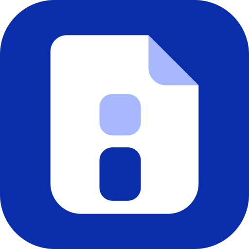

<p align="center">
  
</p>

<h1 align="center">InTab PDF</h1>

<p align="center">
  Privacy-first PDF tools that run entirely on your device.<br>
  No account. No uploads. No tracking. No ads.
</p>

<p align="center">
  A community project by <a href="https://github.com/intabtools">intabtools</a>, made by students, for everyone.
</p>

<p align="center">
  <a href="https://github.com/intabtools/intabpdf/actions/workflows/build.yml"></a>
</p>

<p align="center">
  
  
  
  
  
  
  
</p>

---

## We are just getting started

InTab PDF is a very new project. There is no finished tool yet, and the screens are still being planned. This is a great time to join, because you can help decide how everything looks and works.

Whether you write code, design screens, test on your phone, fix a spelling mistake in the docs, or just have an idea, you are welcome here.

## Why InTab PDF

Most online PDF tools ask you to upload your files to a server. We do not think that is right, so InTab PDF works differently.

- Everything runs on your device.
- No backend, no account, no tracking, no ads.
- Open source and community driven.

## How we build

We are a group of students, so the code must be easy for everyone to read and change. We follow four simple goals.

- **Simple.** The plain way is the best way. No clever tricks.
- **Modular.** One tool, one folder. Tools do not depend on each other.
- **Explainable.** You should be able to say what a file does in one or two sentences.
- **Maintainable.** Small PRs, tests for PDF logic, and docs that match the code.

## Platforms

| Platform | Technology | Status |
|---|---|---|
| Web | Vite + React + TypeScript | Just starting |
| Desktop | Electron | Foundation added, screens still to come |
| Android | Capacitor | Planned for later |

## Quick start

You need [Node.js](https://nodejs.org) (current LTS).

```bash
git clone https://github.com/intabtools/intabpdf.git
cd intabpdf
npm install
npm run dev
```

The app may not show much yet, and that is okay. We are building it step by step.

## Want to help?

1. Read [contributing.md](https://github.com/intabtools/intabpdf/blob/main/docs/contributing.md). It is short.
2. Look for issues labelled `good first issue`.
3. Ask questions anytime. Nobody expects you to know everything.

## Docs

You do not need to read everything. Start with the first two files and come back to the others when you need them.

| File | What it covers |
|---|---|
| [contributing.md](https://github.com/intabtools/intabpdf/blob/main/docs/contributing.md) | How to help, step by step |
| [architecture.md](https://github.com/intabtools/intabpdf/blob/main/docs/architecture.md) | How we plan to arrange the code |
| [folder-guide.md](https://github.com/intabtools/intabpdf/blob/main/docs/folder-guide.md) | What each folder is for |
| [adding-a-tool.md](https://github.com/intabtools/intabpdf/blob/main/docs/adding-a-tool.md) | Build a new tool step by step |
| [privacy.md](https://github.com/intabtools/intabpdf/blob/main/docs/privacy.md) | Our privacy promise and rules |
| [commit-conventions.md](https://github.com/intabtools/intabpdf/blob/main/docs/commit-conventions.md) | How to write commit messages |
| [code-quality.md](https://github.com/intabtools/intabpdf/blob/main/docs/code-quality.md) | Friendly tips for clean code |
| [dependencies.md](https://github.com/intabtools/intabpdf/blob/main/docs/dependencies.md) | Adding libraries safely |
| [platforms.md](https://github.com/intabtools/intabpdf/blob/main/docs/platforms.md) | Web, desktop and Android plans |
| [maintainer-guide.md](https://github.com/intabtools/intabpdf/blob/main/docs/maintainer-guide.md) | For people who review PRs and make releases |
| [decisions.md](https://github.com/intabtools/intabpdf/blob/main/docs/decisions.md) | Why we made some key choices |

## Security

Found a security or privacy problem? Please tell us privately. See [SECURITY.md](SECURITY.md).

## License

See [LICENSE](LICENSE).