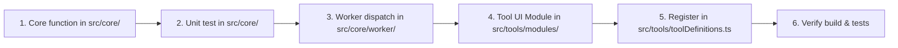

# Adding a New Tool to InTabPDF

InTabPDF uses a modular, plug-and-play architecture for all PDF tools. Adding a new tool requires no changes to the app router, navigation layout, or platform shells.

---

## 1. Overview of Steps



---

## 2. Step-by-Step Implementation Guide

### Step 1: Implement the Pure PDF Operation in `src/core/`

Create or extend a function in `src/core/` (e.g., `src/core/compress.ts`). The function must be pure: accept byte buffers and options, and return a transformed `Uint8Array`.

```typescript
// src/core/compress.ts
import { PDFDocument } from 'pdf-lib';

export interface CompressOptions {
  shrinkImages?: boolean;
}

export async function compressPdf(
  buffer: Uint8Array,
  options?: CompressOptions
): Promise<Uint8Array> {
  const doc = await PDFDocument.load(buffer);
  // Perform PDF compression or stripping operations
  return await doc.save({ useObjectStreams: true });
}
```

Export the function from [src/core/index.ts](../src/core/index.ts):
```typescript
export * from './compress';
```

### Step 2: Write Unit Tests

Add unit tests in [src/core/pdf.test.ts](../src/core/pdf.test.ts) using `vitest`:
```typescript
describe('compressPdf', () => {
  it('compresses a PDF document and produces valid output', async () => {
    const testPdf = await createTestPdf(3);
    const compressed = await compressPdf(testPdf);
    expect(compressed).toBeInstanceOf(Uint8Array);
    expect(compressed.byteLength).toBeGreaterThan(0);
  });
});
```

### Step 3: Add to the Web Worker and Processing Service

If your tool performs heavy document manipulation using `pdf-lib`:
1. Update [src/core/worker/service.ts](../src/core/worker/service.ts):
   - Add the operation key to `PdfOperation`:
     ```typescript
     export type PdfOperation = 'merge' | 'rotate' | 'remove-pages' | 'split' | 'images-to-pdf' | 'compress';
     ```
   - Define the payload structure in `OperationPayloads`:
     ```typescript
     export interface OperationPayloads {
       // ...
       compress: { buffer: Uint8Array; options?: CompressOptions };
     }
     ```
   - Add the operation to `executeOnMainThread()` in `service.ts`.
2. Update [src/core/worker/pdfWorker.ts](../src/core/worker/pdfWorker.ts) in the worker message handler `switch` block.

*(Note: Tools that render or parse pages using `pdfjs-dist`, such as `pdf-to-images` and `extract-text`, invoke PDF.js methods directly on typed byte arrays; PDF.js internally manages its own background Web Worker thread `pdf.worker.min.mjs`.)*

### Step 4: Create the Tool UI Module in `src/tools/modules/`

Create `src/tools/modules/CompressTool.tsx`. This module renders tool-specific options and executes the job via `pdfProcessingService`:

```tsx
import type { ReactNode } from 'react';
import OutputFilenameInput from '../../components/OutputFilenameInput';
import type { ToolComponentProps } from '../types';
import { pdfProcessingService } from '../../core/worker/service';

export default function CompressTool({
  tool,
  stagedFiles,
  optionsState,
  onOptionsChange,
  onExecute,
  isProcessing,
  outputBaseName,
  onOutputBaseNameChange,
  defaultBaseName,
  outputExtension,
}: ToolComponentProps): ReactNode {
  const handleRun = () => {
    onExecute(async () => {
      const buffer = stagedFiles[0].bytes;

      return await pdfProcessingService.execute('compress', {
        buffer,
        options: {
          shrinkImages: optionsState['shrink'],
        },
      });
    });
  };

  return (
    <div className="card opts">
      <b>{tool.name} options</b>
      {/* Tool options checkboxes or sliders */}

      <OutputFilenameInput
        value={outputBaseName ?? ''}
        onChange={onOutputBaseNameChange ?? (() => {})}
        placeholder={defaultBaseName ?? 'compressed-document'}
        extension={outputExtension ?? '.pdf'}
      />

      <button
        type="button"
        className="cta"
        onClick={handleRun}
        disabled={isProcessing || stagedFiles.length === 0}
      >
        Compress PDF
      </button>
    </div>
  );
}
```

### Step 5: Register the Tool in `src/tools/toolDefinitions.ts`

Find or declare your tool definition in [src/tools/toolDefinitions.ts](../src/tools/toolDefinitions.ts) (which is re-exported by `src/tools/registry.ts`):
```typescript
{
  id: 'compress',
  name: 'Compress',
  description: 'Shrink file size without losing quality',
  category: 'Shrink and secure',
  icon: 'file-down',
  fileType: 'pdf',
  actionVerb: 'Compress',
  noun: 'file',
  outputName: 'compressed.pdf',
  availability: 'available', // change from 'coming-soon' to 'available'
  component: () => import('./modules/CompressTool'),
  options: [
    { id: 'shrink', label: 'Compress images', description: 'Downsample large photos', defaultValue: true },
  ],
}
```

Once registered in `src/tools/toolDefinitions.ts`, the tool is immediately recognized throughout the application. The application shell and [src/pages/ToolPage.tsx](../src/pages/ToolPage.tsx) resolve the lazy component wrapper automatically via [`getToolComponent(tool)`](../src/tools/registry.ts) without requiring edits to routing definitions or navigation bars.

---

## 3. Verification

Always run the verification suite to ensure zero regressions:

```bash
# 1. Type check and linting
npm run lint

# 2. Unit and worker tests (Vitest)
npm test

# 3. End-to-end browser workflows (Playwright)
npm run test:e2e

# 4. Production Web build (verifies dynamic chunk splitting)
npm run build

# 5. Electron desktop build
npm run build:desktop

# 6. Android asset synchronization and native compilation
npm run sync:android
npm run android:build
```
