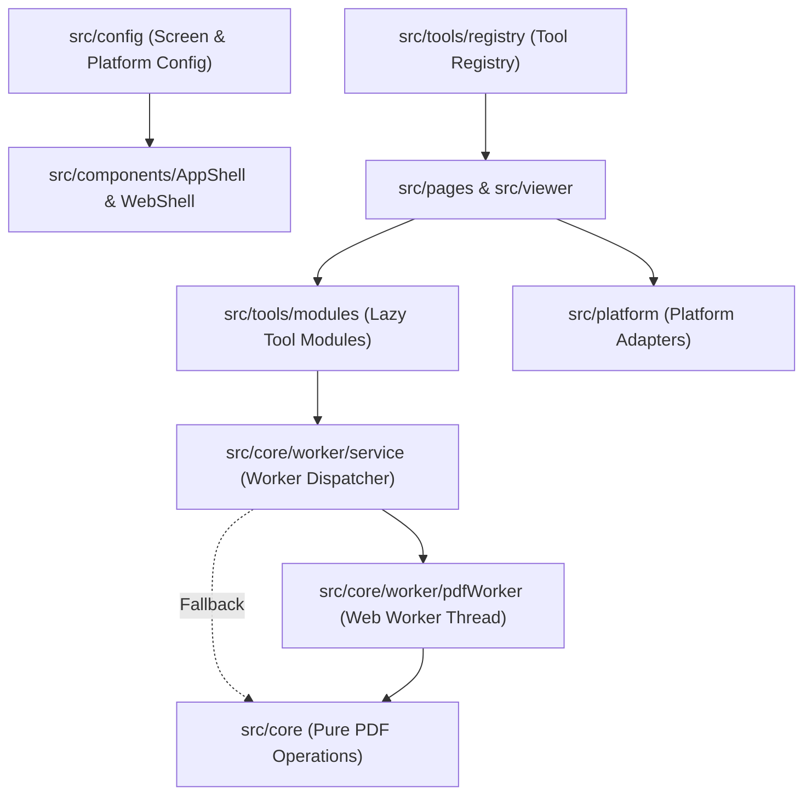
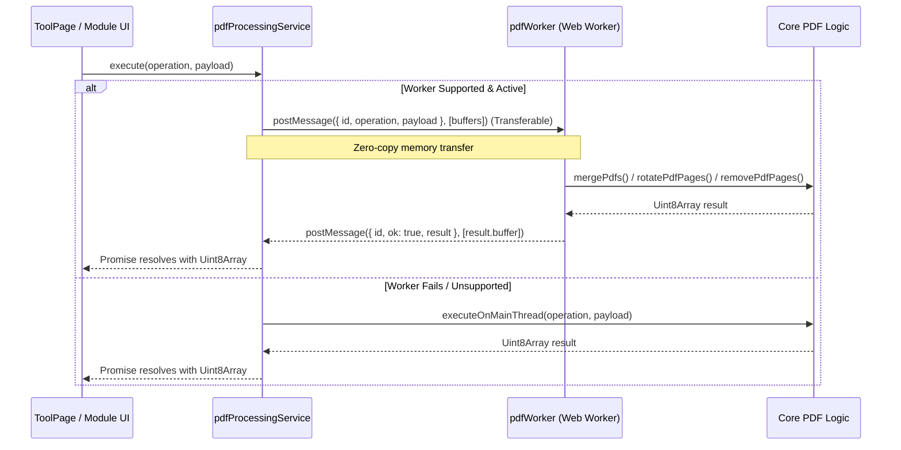

# InTabPDF Architecture

InTabPDF is a privacy-first, client-only PDF application running across Web browsers, Electron desktop, and Android (via Capacitor).

There is zero backend server, zero analytics/telemetry, zero database, and zero network dependency during operation. All 13 core PDF tools and the viewer parse, render, and manipulate documents in device memory; on Android, native plugins handle SAF file saving/recovery, incoming share targets, and on-device camera scanning using app-private storage.

---

## 1. Core Architecture Boundaries

The application enforces a unidirectional dependency hierarchy across seven decoupled domains:



### Architectural Responsibilities

1. **Application Configuration (`src/config/screens.ts`)**
   - Declares enabled screens per platform (`home`, `viewer`, `tools`, `about`).
   - The embedded `/viewer` screen is explicitly disabled on `web` (`isScreenEnabled('viewer', 'web') === false`) to eliminate redundant embedded reader overhead, while remaining active on `electron` and `android`.
   - Defines platform-specific initial destinations (`web: '/'`, `electron: '/'`, `android: '/'`).
   - Configures default shell visibility (`showAppLayout: true`).
   - Implements `resolveDestination(path, platform)` to provide deterministic fallbacks (e.g. redirecting `/viewer` to `/` on web).

2. **Screen and Tool Registry (`src/tools/registry.ts`, `src/tools/toolDefinitions.ts`)**
   - Authoritative registry of all 13 PDF tools across 4 categories (`Create`, `Organize`, `Shrink and secure`, `Sign and convert`).
   - All 13 tools are fully implemented (`availability: 'available'`): `images-to-pdf`, `text-to-pdf`, `merge`, `split`, `reorder`, `rotate`, `remove-pages`, `compress`, `protect`, `unlock`, `sign`, `pdf-to-images`, and `extract-text`.
   - Encapsulates tool metadata, icon names, action verbs, input file types, multi-file support, default options, and availability (`'available' | 'coming-soon'`).
   - Exposes lazy module references (`component?: () => import(...)`) for on-demand loading.
   - Enforces validation via `validateRegistry()` with runtime assertions for ID uniqueness and availability consistency.

3. **Routing and Dynamic Screen Resolution (`src/App.tsx`, `src/platform/AppRouter.tsx`)**
   - Selects `BrowserRouter` for standard web environments and `HashRouter` for desktop/mobile packaged apps.
   - All top-level screens (`HomePage`, `ViewerPage`, `AboutPage`, `ToolPage`) are loaded via `React.lazy()` with `Suspense` fallbacks and error boundary protection.
   - Unknown routes redirect cleanly to the platform's initial destination.

4. **Platform Shells (`src/components/AppShell.tsx`, `src/components/WebShell.tsx`)**
   - Renders platform-appropriate chrome (`web` website shell vs. `desktop` / `mobile` app shell).
   - Injects `data-platform` (`web`, `electron`, `android`) and `data-shell` (`web`, `app`) attributes into `<div id="root">`.
   - Supports temporary full-screen mode via `showAppLayout === false`, automatically unmounting headers, sidebars, and navigation rails while retaining Escape / Android back button dismissal.

5. **Dynamic Tool Modules (`src/tools/modules/`)**
   - Independent options panels and action runners for each tool (for example, `MergeTool.tsx`, `SplitTool.tsx`, `CompressTool.tsx`, `ProtectTool.tsx`, `SignTool.tsx`, and `ExtractTextTool.tsx`).
   - Code-split into isolated chunks; neither the UI nor their PDF dependencies (`pdf-lib`) are bundled into the initial startup payload.

6. **Centralized Web Worker Processing Service (`src/core/worker/`)**
   - Dispatches heavy PDF processing tasks off the main JavaScript UI thread via a centralized singleton `pdfProcessingService` (`src/core/worker/service.ts`).
   - Dedicated Web Worker thread (`src/core/worker/pdfWorker.ts`) executes `pdf-lib` document manipulations.
   - Zero-copy data transfer utilizing transferable `ArrayBuffer` objects with defensive buffer isolation.
   - Operation-specific timeout guards (`60s` for `rotate`, `remove-pages`, `text-to-pdf`, `reorder`, `sign`, `protect`, `unlock`; `120s` for `merge` and `split`; `180s` for `compress` and `images-to-pdf`, or a custom `timeoutMs`).
   - Automatic graceful fallback to main-thread execution if Web Workers are unavailable, disabled, or encounter fatal startup errors.
   - Tools leveraging Mozilla PDF.js (`pdf-to-images` and `extract-text`) utilize `pdfjs-dist` and its dedicated worker (`pdf.worker.min.mjs`) rather than `pdf-lib`.

7. **Pure PDF Core (`src/core/`)**
   - Zero DOM or browser dependencies: accepts typed byte arrays (`Uint8Array`) and returns transformed byte arrays.
   - 100% testable via unit tests in headless environments without DOM mocking.

8. **Platform Integration Layer, Electron IPC, & Android Native Plugins (`src/platform/`, `electron/`, `android/`)**
   - Standardizes file selection, saving, sharing, scanning, and OS-level file opening across Web, Electron IPC, and Capacitor plugins.
   - Electron desktop shell communicates securely via context isolation and the `window.intab` bridge API (`hasPendingPdf`, `clearPendingPdf`, `onOpenPdf`, `onOpenPdfError`, `onOpenPdfStart`, `openExternalUrl`, `copyText`, `setViewerCopyAllowed`, `onContextSelectAll`).
   - Android native integration includes `window.NativeIntent` (in `MainActivity.java`) for opening `content://` PDFs, `DocumentSavePlugin` (`SafSaveRepository` + `SafRecoveryStore`) for SAF saving, collision prompts, staged-swap/`"wt"` replacement, and crash-safe recovery export, `DocumentScannerPlugin` (`ScannerActivity` using CameraX + OpenCV + Android `PdfDocument`) for the Android-only document scanner, `SaveToDeviceActivity` as a separate `SEND`/`SEND_MULTIPLE` share target, and `share.ts` (`@capacitor/filesystem` + `@capacitor/share`) for viewer sharing.

---

## 2. On-Demand Dynamic Loading & Code Splitting

Heavy libraries such as `pdf-lib` (~420 KB) and `pdfjs-dist` (~440 KB + 1.2 MB worker) are never loaded during the initial application startup.

### Bundle Structure (Vite Production Build)

| Bundle Chunk | Content | Loaded When |
|---|---|---|
| `index-<hash>.js` | App Shell, React runtime, Router, Navigation icons | Initial page load |
| `HomePage-<hash>.js` | Tool discovery grid, categories, search | Home route (`/`) |
| `ViewerPage-<hash>.js` | PDF.js canvas renderer, zoom, page thumbnails | Viewer route (`/viewer` on Desktop/Android) |
| `pdf.worker.min-<hash>.mjs` | PDF.js parsing web worker | Viewer / PDF.js initialization |
| `ToolPage-<hash>.js` | File staging area, drag-and-drop, common tool cards | Tool route (`/tool/:toolId`) |
| `ImagesToPdfTool-<hash>.js` | Image reorder, preview lightbox, page setup | Active tool is `images-to-pdf` |
| `TextToPdfTool-<hash>.js` | Text input/file options & PDF creation | Active tool is `text-to-pdf` |
| `MergeTool-<hash>.js` | Merge options & execution handler | Active tool is `merge` |
| `SplitTool-<hash>.js` | Split mode & range selection | Active tool is `split` |
| `ReorderTool-<hash>.js` | Page order input & reordering handler | Active tool is `reorder` |
| `RotateTool-<hash>.js` | Rotation degree picker & handler | Active tool is `rotate` |
| `RemovePagesTool-<hash>.js` | Page range selector & validator | Active tool is `remove-pages` |
| `CompressTool-<hash>.js` | Target size input & presets | Active tool is `compress` |
| `ProtectTool-<hash>.js` | Password & permissions encryption options | Active tool is `protect` |
| `UnlockTool-<hash>.js` | Password decryption options | Active tool is `unlock` |
| `SignTool-<hash>.js` | Draw / Type / Upload visual signature options | Active tool is `sign` |
| `PdfToImagesTool-<hash>.js` | Image format, DPI, quality & ZIP export | Active tool is `pdf-to-images` |
| `ExtractTextTool-<hash>.js` | Multi-page text preview & TXT download | Active tool is `extract-text` |
| `core-<hash>.js` | `pdf-lib` manipulation engine | Any tool executes or loads core |
| `pdfWorker-<hash>.js` | Background worker executing operations | Dispatched tool operation |

---

## 3. Web Worker Processing Flow

All document operations follow a non-blocking asynchronous pipeline:



### Worker Memory Management & Error Recovery
- **Defensive Buffer Isolation:** When transferring `ArrayBuffer`s to the worker thread via `postMessage`, the service slices the buffers so only the transferred slice is detached. The caller's original `Uint8Array` in the main thread remains intact and non-neutered, ensuring the user can retry or adjust options, and allowing seamless fallback to main thread.
- **Runaway Process Termination on Timeout and Cancellation:** Each active request creates a dedicated Web Worker (`new Worker(...)`) that is terminated after completion, failure, timeout, or cancellation. When an operation exceeds its configured timeout (60s for `rotate`, `remove-pages`, `text-to-pdf`, `reorder`, `sign`, `protect`, `unlock`; 120s for `merge` and `split`; 180s for `compress` and `images-to-pdf`; or a custom `timeoutMs`) or is aborted via `ExecuteOptions.signal`, the request settles with `TimeoutError`/`AbortError`, queued requests are removed if still queued, active Web Workers are terminated immediately via `terminateAndDetachWorker()`, and main-thread fallbacks receive the abort signal cooperatively. Calling `terminateWorker()` manually terminates only the active dispatched worker without rejecting pending or queued requests.
- **Worker Initialization & Script Failures:** If `new Worker()` throws, `worker.onerror` fires, or `onmessageerror` occurs, `service.ts` increments `consecutiveSpawnFailures`; once `consecutiveSpawnFailures >= 3`, it marks `isWorkerSupported = false` and routes subsequent requests to `executeOnMainThread`. Task execution errors inside a worker reject directly without falling back to the main thread.
- **Worker Limitations & Transparent State:** Worker execution vs. main-thread fallback is transparent to the UI layer; both present the same `status === 'busy'` / `isProcessing` state. Operations dispatched through `pdfProcessingService` do not emit per-step progress percentages, whereas `PdfToImagesTool` and multi-file batch operations (`executeBatchOperation`) report per-page and per-file progress via `ProcessingContext.updateMessage`.

---

## 4. Platform UI & Scrollbar Strategy

To provide a native-quality feel across target operating systems, InTabPDF uses platform-conditional styling driven by the `data-platform` root attribute:

| Platform | Scrollbar Presentation | Layout Characteristics |
|---|---|---|
| **Android / Mobile** (`android`) | Hidden scrollbar tracks (`scrollbar-width: none; ::-webkit-scrollbar { display: none }`). Natural touch fling scrolling. | Full-bleed drawer overlay under status bar (`var(--sat)`), bottom navigation above gesture inset (`var(--sab)`). 2-column touch-friendly tool grid. |
| **Electron Desktop** (`electron`) | Transient floating scrollbar (6px width, transparent track, thumb visible during scroll/hover). | Persistent desktop sidebar (`width: 232px`), collapsible to 64px (`Ctrl+B`), native title bar integration, responsive 2 to 6 column dashboard grid (`max-width: 1560px`). |
| **Web Browser** (`web`) | Subtle browser-style scrollbar (8px width, accessible contrast). | Responsive centered container (`max-width: 1120px` to `1520px` on wide screens), top sticky navigation header, breadcrumbs. |

---

## 5. Security & Privacy Model

- **Local Execution:** PDFs are loaded into browser memory buffers. No remote API endpoints or analytics trackers exist.
- **Content Security Policy (CSP):** Delivered via Cloudflare Pages HTTP response headers in `public/_headers`:
  ```http
  Content-Security-Policy: default-src 'self'; script-src 'self' 'wasm-unsafe-eval'; style-src 'self' 'unsafe-inline'; img-src 'self' data: blob:; font-src 'self' data:; connect-src 'self' blob:; worker-src 'self' blob:; object-src 'none'; frame-ancestors 'none'; form-action 'self'; base-uri 'self';
  ```
  - `'wasm-unsafe-eval'` is required to allow WebAssembly compilation for PDF.js fast-path rendering.
  - `'unsafe-inline'` in `style-src` is required for dynamic canvas positioning and UI component styling.
  - `connect-src 'self' blob:` allows same-origin fetches and local `blob:` URL reads while blocking external network endpoints.
  - `object-src 'none'` prevents plugin embedding exploits.
- **Permissions-Policy:** Enforces `camera=(), microphone=(), geolocation=()`, disabling those browser device APIs.
- **Zero Third-Party CDNs:** Fonts, icons, and PDF worker scripts are compiled into local production assets.
- **Verification:** Production CSP can be verified locally against `dist/` and `public/_headers` via `scripts/test-csp-runtime.mjs`. (Note: in the viewer selection menu, the explicitly user-initiated **Search the web** button opens Google Search in the user's browser with up to 200 characters of selected text; no document data is sent automatically.)

---

## 6. Web PDF Viewing Architecture

On the web platform (`platform === 'web'`), embedded PDF viewing is replaced with native browser tab viewing via `src/platform/webPdf.ts`:

- **Native Browser Tab Viewing:** `openPdfInNewTab(bytes, fileName)` creates an `application/pdf` Blob URL appended with `#filename=${encodeURIComponent(fileName)}` and opens it in a new browser tab (`target="_blank"`). This allows users to leverage their browser's native viewer (with built-in printing, zooming, saving, and search) without the overhead of loading PDF.js inside the web app shell.
- **Blob URL Lifecycle Tracking:** All generated Blob URLs are registered with a timestamp. To prevent memory leaks, URLs are automatically revoked after 10 minutes. In addition, an event listener on `beforeunload` ensures all active tracked Blob URLs are revoked when the tab unloads.
- **Popup Blocking Graceful Handling:** If `window.open` returns `null` or is blocked by browser security settings, `openPdfInNewTab` returns `false`, enabling callers (such as `ToolPage` and `HomePage`) to show a clear user toast offering an immediate fallback download.

---

## 7. UI Text Selection Policy

To provide a refined application feel and prevent accidental text selection during drag-and-drop, reordering, and button clicks, InTabPDF defines a deliberate selection policy in `src/styles/base.css`:

- **Chrome and Interactive Elements (`user-select: none`):**
  - Application headers, navigation bars, tab bars, and drawers.
  - Sidebar navigation items, command palette triggers, and status bar.
  - Action buttons, icon buttons, badges, drag handles, and reordering grips.
  - Drop zones, tool cards, and summary stats.
- **Selectable Content Elements (`user-select: text`):**
  - All form controls (`input`, `textarea`, `select`).
  - Output filename inputs (`.ofn-input`) and tool parameters.
  - Detailed error messages, crash reports, and technical callouts.
  - Code blocks (`code`, `pre`) and documentation snippets.
  - PDF text layer elements (`.textLayer`) within the desktop/Android viewer.

---

## 8. Electron IPC Bridge Architecture

In the desktop application (`platform === 'electron'`), communication between the Node.js main process (`electron/main.cjs`) and the isolated React renderer is strictly governed by `electron/preload.cjs`:

- **Security Boundaries:** Context isolation (`contextIsolation: true`) and sandbox (`sandbox: true`) are strictly enabled. Node integration (`nodeIntegration: false`) is disabled.
- **`window.intab` Bridge Interface:** Exposes only a minimal, safe API surface:
  - `hasPendingPdf(): boolean`: Synchronously checks if a PDF file was passed via OS CLI argument or file association on launch.
  - `clearPendingPdf(): void`: Clears pending launch file queues in main process and preload backlog.
  - `onOpenPdf(callback: (file: OpenedFile) => void): () => void`: Subscribes to OS file open events. Backlogs events if the renderer is still initializing; notifies the main process via `renderer-ready`.
  - `onOpenPdfError(callback: (errorData: { name: string; error: string }) => void): () => void`: Receives notification if an OS-opened file cannot be read.
  - `onOpenPdfStart(callback: (startData: { name: string }) => void): () => void`: Receives notice when reading a large file from disk commences.
  - `openExternalUrl(url: string): void`: Requests the main process to open an allowed external URL in the user's default OS browser. `electron/main.cjs` restricts this strictly to `https:` URLs targeting the canonical repository (`https://github.com/intabtools/intabpdf` and subpaths) or Google Search (`https://www.google.com/search` and `https://google.com/search`).
  - `copyText(text: string): Promise<boolean>`, `setViewerCopyAllowed(allowed: boolean): void`, and `onContextSelectAll(callback: () => void): () => void`: Coordinate the scoped native right-click context menu and clipboard copy permissions for the viewer.
