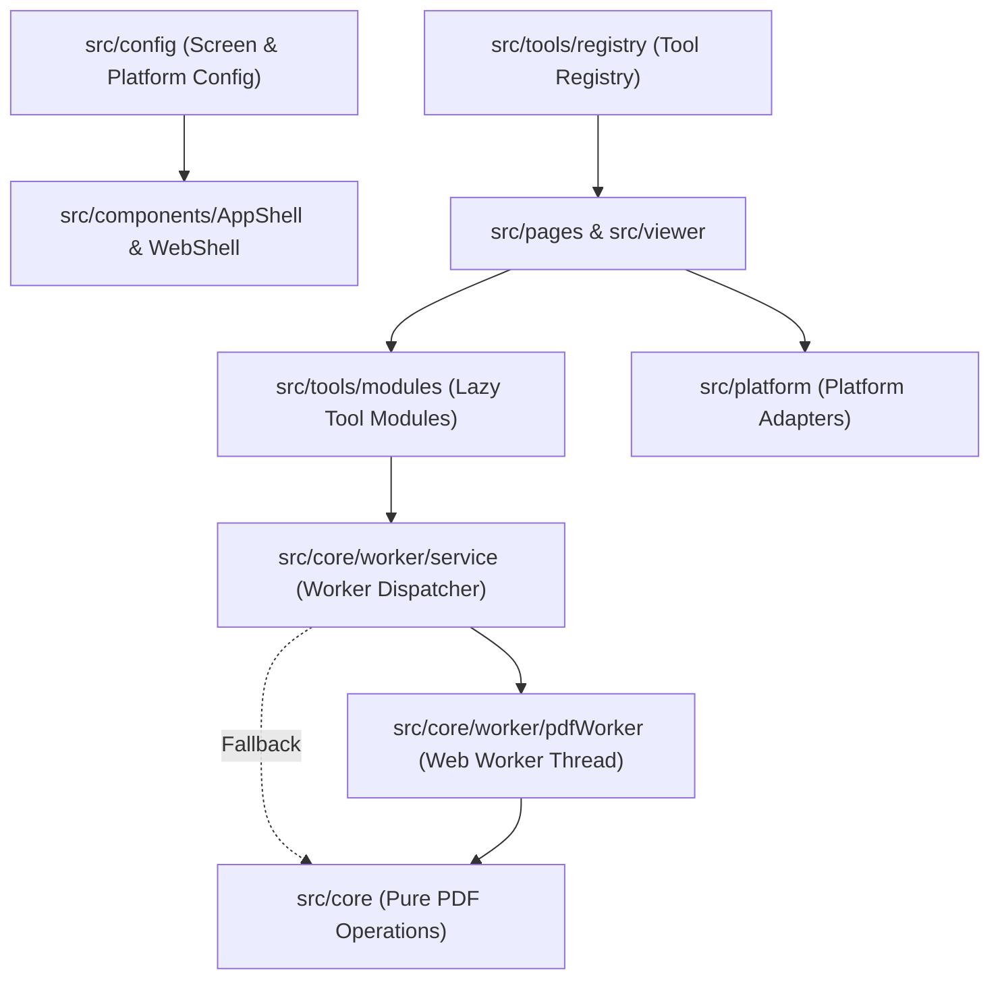
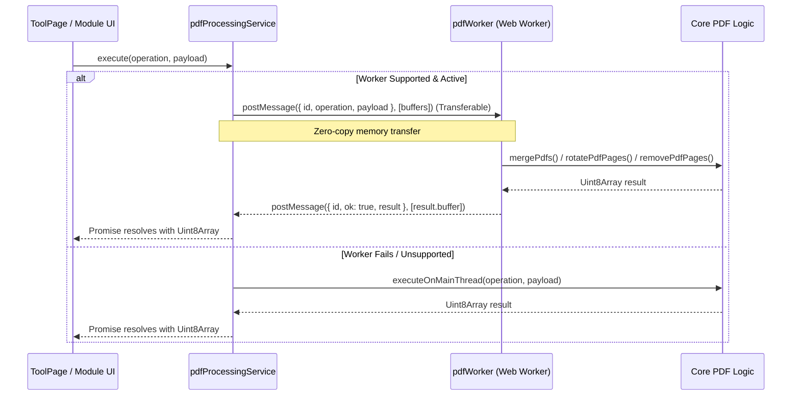

# InTabPDF Architecture

InTabPDF is a privacy-first, client-only PDF application running across Web browsers, Electron desktop, and Android (via Capacitor).

There is zero backend server, zero analytics/telemetry, zero database, and zero network dependency during operation. All PDF document processing, parsing, rendering, and manipulation occur entirely inside the user's device memory.

---

## 1. Core Architecture Boundaries

The application enforces a unidirectional dependency hierarchy across seven decoupled domains:

### Architectural Responsibilities

1. **Application Configuration (`src/config/screens.ts`)**
   - Declares enabled screens (`home`, `viewer`, `tools`, `about`).
   - Defines platform-specific initial destinations (`web: '/'`, `electron: '/'`, `android: '/'`).
   - Configures default shell visibility (`showAppLayout: true`).
   - Implements `resolveDestination(path, platform)` to provide deterministic fallbacks when navigating to disabled or non-existent routes.

2. **Screen and Tool Registry (`src/tools/registry.ts`)**
   - Authoritative registry of all 13 PDF tools across 4 categories (`Create`, `Organize`, `Shrink and secure`, `Sign and convert`).
   - Encapsulates tool metadata, icon names, action verbs, input file types, default options, and availability (`'available' | 'coming-soon'`).
   - Exposes lazy module references (`component?: () => import(...)`) for on-demand loading.
   - Enforces validation via `validateRegistry()` with runtime assertions for ID uniqueness and availability consistency.

3. **Routing and Dynamic Screen Resolution (`src/App.tsx`, `src/platform/AppRouter.tsx`)**
   - Selects `BrowserRouter` for standard web environments and `HashRouter` for desktop/mobile packaged apps.
   - All top-level screens (`HomePage`, `ViewerPage`, `AboutPage`, `ToolPage`) are loaded via `React.lazy()` with `Suspense` fallbacks and error boundary protection.
   - Unknown routes redirect cleanly to the platform's initial destination.

4. **Platform Shells (`src/components/AppShell.tsx`, `src/components/WebShell.tsx`)**
   - Renders platform-appropriate chrome (`web` website shell vs. `desktop` / `mobile` app shell).
   - Injects `data-platform` (`web`, `electron`, `android`) and `data-shell` (`web`, `app`) attributes into `
`.
   - Supports temporary full-screen mode via `showAppLayout === false`, automatically unmounting headers, sidebars, and navigation rails while retaining Escape / Android back button dismissal.

5. **Dynamic Tool Modules (`src/tools/modules/`)**
   - Independent options panels and action runners for each tool (e.g., `MergeTool.tsx`, `RotateTool.tsx`, `RemovePagesTool.tsx`).
   - Code-split into isolated chunks; neither the UI nor their PDF dependencies (`pdf-lib`) are bundled into the initial startup payload.

6. **Web Worker Processing Service (`src/core/worker/`)**
   - Dispatches heavy PDF processing tasks off the main JavaScript UI thread.
   - Zero-copy data transfer utilizing transferable `ArrayBuffer` objects.
   - Built-in 60-second execution timeout guard.
   - Automatic graceful fallback to main-thread execution if Web Workers are unavailable, disabled, or encounter fatal startup errors.

7. **Pure PDF Core (`src/core/`)**
   - Zero DOM or browser dependencies: accepts typed byte arrays (`Uint8Array`) and returns transformed byte arrays.
   - 100% testable via unit tests in headless environments without DOM mocking.

8. **Platform Integration Layer (`src/platform/`)**
   - Standardizes file selection, saving, sharing, and OS-level file opening across Web, Electron IPC, and Capacitor plugins.

---

## 2. On-Demand Dynamic Loading & Code Splitting

Heavy libraries such as `pdf-lib` (~420 KB) and `pdfjs-dist` (~440 KB + 1.2 MB worker) are never loaded during the initial application startup.

### Bundle Structure (Vite Production Build)

| Bundle Chunk | Content | Loaded When |
|---|---|---|
| `index-<hash>.js` (~295 KB) | App Shell, React runtime, Router, Navigation icons | Initial page load |
| `HomePage-<hash>.js` (~4.6 KB) | Tool discovery grid, categories, search | Home route (`/`) |
| `ViewerPage-<hash>.js` (~443 KB) | PDF.js canvas renderer, zoom, page thumbnails | Viewer route (`/viewer`) |
| `pdf.worker.min-<hash>.mjs` (~1.2 MB) | PDF.js parsing web worker | Viewer initialization |
| `ToolPage-<hash>.js` (~7.5 KB) | File staging area, drag-and-drop, common tool cards | Tool route (`/tool/:toolId`) |
| `MergeTool-<hash>.js` (~1.1 KB) | Merge options & execution handler | Active tool is `merge` |
| `RotateTool-<hash>.js` (~1.1 KB) | Rotation degree picker & handler | Active tool is `rotate` |
| `RemovePagesTool-<hash>.js` (~1.8 KB) | Page range selector & validator | Active tool is `remove-pages` |
| `core-<hash>.js` (~423 KB) | `pdf-lib` manipulation engine | Any tool executes or loads core |
| `pdfWorker-<hash>.js` (~426 KB) | Background worker executing operations | Dispatched tool operation |

---

## 3. Web Worker Processing Flow

All document operations follow a non-blocking asynchronous pipeline:

### Worker Memory Management & Error Recovery
- **Defensive Buffer Isolation:** When transferring `ArrayBuffer`s to the worker thread via `postMessage`, the service slices the buffers so only the transferred slice is detached. The caller's original `Uint8Array` in the main thread remains intact and non-neutered, ensuring the user can retry or adjust options, and allowing seamless fallback to main thread.
- **Runaway Process Termination on Timeout:** If an operation exceeds the 60-second timeout, the request promise is rejected, pending listeners are cleared, and `terminateWorker()` kills the runaway worker thread to prevent CPU starvation and queue blockage.
- **Worker Initialization & Script Failures:** If `new Worker()` throws or the worker script triggers `worker.onerror`, `service.ts` marks `isWorkerSupported = false`, terminates the failed worker, and routes all current and subsequent requests to `executeOnMainThread`.
- **Worker Limitations & Transparent State:** Worker execution vs. main-thread fallback is transparent to the UI layer; both present the same `status === 'busy'` / `isProcessing` state. Individual worker operations currently execute to completion without fine-grained progress percentages or per-task cooperative cancel tokens; job cancellation is performed at the worker lifecycle level via `terminateWorker()`.

---

## 4. Platform UI & Scrollbar Strategy

To provide a native-quality feel across target operating systems, InTabPDF uses platform-conditional styling driven by the `data-platform` root attribute:

| Platform | Scrollbar Presentation | Layout Characteristics |
|---|---|---|
| **Android / Mobile** (`android`) | Hidden scrollbar tracks (`scrollbar-width: none; ::-webkit-scrollbar { display: none }`). Natural touch fling scrolling. | Full-bleed drawer overlay under status bar (`var(--sat)`), bottom navigation above gesture inset (`var(--sab)`). |
| **Electron Desktop** (`electron`) | Transient floating scrollbar (6px width, transparent track, thumb visible during scroll/hover). | Persistent desktop sidebar (`width: 250px`), native title bar integration, keyboard shortcuts. |
| **Web Browser** (`web`) | Subtle browser-style scrollbar (8px width, accessible contrast). | Centered max-width container (`max-width: 1040px`), top marketing header, breadcrumbs. |

---

## 5. Security & Privacy Model

- **Local Execution:** PDFs are loaded into browser memory buffers. No remote API endpoints or analytics trackers exist.
- **Content Security Policy (CSP):** Enforces `default-src 'self' blob:; object-src 'none'; script-src 'self' 'wasm-unsafe-eval'`.
- **Zero Third-Party CDNs:** Fonts, icons, and PDF worker scripts are compiled into local production assets.
