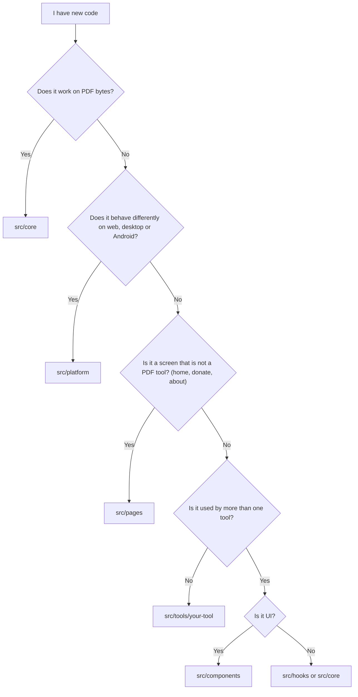

# Folder guide

This page tells you what each folder is for, so you know where to put your code. Some of these folders do not exist yet (they are marked *later* below). We will create them when we need them, so please do not worry if you cannot find one.

## Where should my code go?

Use this chart when you are not sure.



Still confused? Put it inside your own tool folder and ask in your PR. We can move it later.

## Layout

```
intabpdf/
├── public/              Static files served as they are (_headers, _redirects, sitemap.xml, favicon.svg)
├── src/
│   ├── core/            PDF logic (bytes in, bytes out)
│   │   ├── worker/      Centralized PDF worker service and worker thread
│   │   ├── merge.ts, split.ts, rotate.ts, remove-pages.ts, compress.ts...
│   │   └── index.ts     Core operations export
│   ├── platform/        Per-platform adapters (web, electron, android)
│   ├── tools/           Tools domain
│   │   ├── modules/     Tool UI components (MergeTool.tsx, SplitTool.tsx, etc.)
│   │   ├── registry.ts  Tool discovery and queries
│   │   ├── toolDefinitions.ts Authoritative tool metadata and options
│   │   ├── filename.ts  Output filename sanitization
│   │   └── types.ts     ToolDefinition and component prop types
│   ├── viewer/          Embedded PDF viewer screen (Electron and Android)
│   ├── pages/           Screens (HomePage, AboutPage, ToolPage)
│   ├── components/      Shared UI (DropZone, ShellContainer, etc.)
│   ├── hooks/           Shared React hooks (useShell, etc.)
│   ├── config/          Screen and routing configuration (screens.ts)
│   ├── styles/          Global CSS and theme variables (tokens.css, base.css, web.css)
│   ├── assets/          Images and icons imported by code
│   ├── App.tsx          Root application component
│   └── main.tsx         Browser entry point
├── electron/            Desktop app shell (main.cjs and preload.cjs)
├── android/             Android app shell (Capacitor project with Gradle guard)
├── e2e/                 Playwright end-to-end test suites and fixtures
├── scripts/             Build and verification scripts (cap.cjs, test-csp-runtime.mjs)
├── .github/workflows/   Continuous Integration workflows (ci.yml)
└── docs/                These documents
```

> **Note:** Heavy PDF operations run in background threads via the centralized service in `src/core/worker/` with zero-copy transferable buffers and automatic fallback. Tools are implemented as independent UI modules in `src/tools/modules/` and registered in `src/tools/toolDefinitions.ts`.

## Folder by folder

### `src/core/`

- **Purpose:** All pure PDF byte operations (merge, split, rotate, remove-pages, compress, images-to-pdf, extract-text).
- **Keep here:** Pure functions (bytes in, bytes out), worker dispatch service in `worker/`, and unit tests.
- **Avoid:** React, `document` or `window`, Electron or Capacitor imports, file paths, UI text.

### `src/platform/`

- **Purpose:** Standardized interface for platform differences: picking files, saving files, sharing, and OS-level file opening.
- **Keep here:** The interface, adapters for Web, Electron bridge (`window.intab`), and Capacitor Android (`window.NativeIntent`).
- **Avoid:** PDF manipulation logic, tool-specific code, UI styling.

### `src/tools/`

- **Purpose:** Everything for PDF tool options and presentation.
- **Keep here:** Tool UI modules in `src/tools/modules/<ToolName>.tsx` (e.g. `MergeTool.tsx`, `RotateTool.tsx`, `PdfToImagesTool.tsx`, `ExtractTextTool.tsx`), `toolDefinitions.ts` (metadata), `registry.ts` (discovery queries), `filename.ts`, and `types.ts`.
- **Avoid:** PDF byte manipulation logic (it belongs in `core`), direct imports between tools, platform checks.

### `src/viewer/`

- **Purpose:** The embedded PDF viewer screen for desktop and Android: open PDF, render pages, navigate, zoom, search text.
- **Keep here:** `ViewerPage.tsx`, canvas rendering helpers (`renderPage.ts`), and viewer-only UI components.
- **Avoid:** PDF editing logic, tool imports.

### `src/components/`

- **Purpose:** UI used across tools and pages (drop zone, app shells, navigation bars, buttons).
- **Keep here:** Reusable, accessible React components that receive data via props.
- **Avoid:** Tool-specific execution logic, direct platform API calls.

### `src/pages/`

- **Purpose:** Top-level route pages: `HomePage.tsx`, `AboutPage.tsx`, and `ToolPage.tsx`.
- **Keep here:** Screen-level composition and layout wiring.
- **Avoid:** Direct PDF byte manipulation.

### `src/hooks/`

- **Purpose:** Shared React hooks (such as `useShell`).
- **Keep here:** Hooks used by multiple components.

### `src/styles/`

- **Purpose:** Global CSS stylesheets and CSS variables (`tokens.css`, `base.css`, `web.css`).
- **Avoid:** One-off component styles.

### `src/assets/`

- **Purpose:** Static assets bundled by Vite (SVGs, local fonts).
- **Avoid:** Large unused binary files.

### `public/`

- **Purpose:** Static assets served directly: `favicon.svg`, `robots.txt`, `sitemap.xml`, and Cloudflare configuration files (`_headers` for CSP and `_redirects` for SPA rewrites).

### `electron/` and `android/`

- **Purpose:** Native application shells.
- **Keep here:** In `electron/`: `main.cjs` and `preload.cjs`. In `android/`: Capacitor configuration and Gradle project.
- **Avoid:** PDF logic. It stays in TypeScript. Never commit signing keys, keystores, or built binaries.

### `e2e/`

- **Purpose:** Playwright end-to-end browser test suites (`startup-and-navigation.spec.ts`, `pdf-workflows.spec.ts`, `invalid-input.spec.ts`) and test fixtures.

### `scripts/`

- **Purpose:** Developer and CI utility scripts (`cap.cjs` for Capacitor CLI Node 20 LTS compatibility, `test-csp-runtime.mjs` for local CSP verification).

### Root files

| File | Purpose |
|---|---|
| `index.html` | Application HTML entry point. Free of remote CDNs or trackers. |
| `package.json` | Project scripts, dependencies, and Electron packaging configuration. |
| `package-lock.json` | Exact pinned dependency tree. |
| `vite.config.ts` | Vite configuration with dynamic chunking and relative base path. |
| `vitest.config.ts` | Vitest unit test configuration (strictly excludes E2E specs). |
| `playwright.config.ts` | Playwright E2E browser test configuration. |
| `tsconfig.json` | Root TypeScript project references configuration. |
| `eslint.config.js` | ESLint rules and flat configuration. |
| `capacitor.config.ts` | Capacitor settings: app ID, app name, and web asset folder. |
| `README.md` | Front-page documentation and quick start. |
| `SECURITY.md` | Vulnerability reporting and security policy. |
| `LICENSE` | MIT Open Source license. |

## Where do types go?

We do not have one big `types/` folder. Keep a type close to the code that uses it. This way you can understand a file without searching the whole project.

| Type | Where it lives |
|---|---|
| Props of a component | In the same component file |
| Options or result of one `core` function | In the same file as the function |
| Types shared by many `core` files | `src/core/types.ts` |
| `PlatformAdapter` | `src/platform/types.ts` |
| `ToolDefinition`, `WorkerRequest`, `WorkerResponse` | `src/tools/types.ts` |
| Types used by one tool only | Inside that tool's folder |

Simple rules:

1. Used by one file? Keep it in that file.
2. Used by many files in one folder? Make a `types.ts` in that folder.
3. Needed by `core` and by other folders? Put it in `core/types.ts`. Other folders can import from `core`, but `core` cannot import from them.

Use `type` for simple shapes and `interface` for things that other code implements, like `PlatformAdapter`.

## Naming

| Thing | Style | Example |
|---|---|---|
| React component file | PascalCase | `DropZone.tsx` |
| Other TypeScript file | camelCase | `mergePdfs.ts` |
| Tool UI module in `modules/` | PascalCase ending in `Tool` | `MergeTool.tsx`, `ExtractTextTool.tsx` |
| Page file in `pages/` | PascalCase ending in `Page` | `HomePage.tsx` |
| Other folders | lowercase | `core`, `components` |
| Worker file | `pdfWorker.ts` (centralized) | `src/core/worker/pdfWorker.ts` |
| Unit / integration test file | same name plus `.test.ts` / `.test.tsx` | `merge.test.ts`, `registry.test.ts` |
| End-to-end test spec | kebab-case ending in `.spec.ts` | `e2e/pdf-workflows.spec.ts` |
| Types | PascalCase | `ToolDefinition` |
