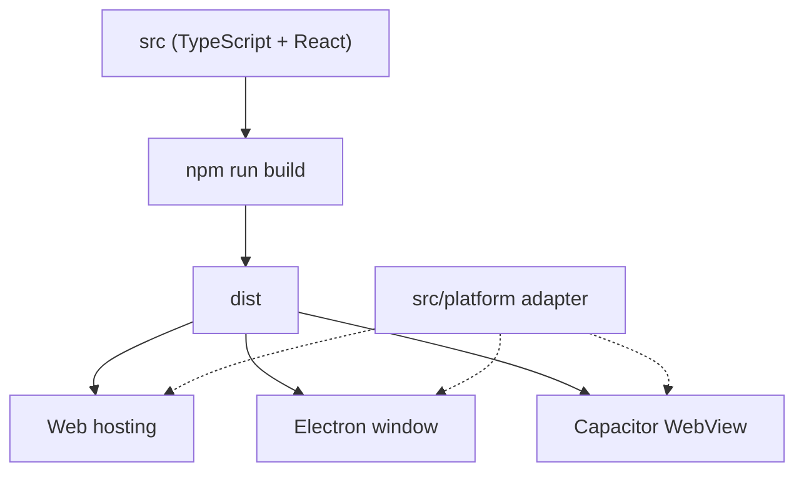
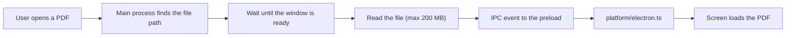
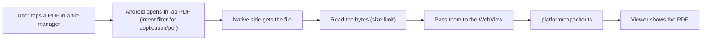

# Platforms

One codebase, three places to run it. All of them load the **same web build** (the `dist` folder).

| Platform | Shell | Folder | Status |
|---|---|---|---|
| Web | Vite static build | root | Just starting |
| Desktop | Electron | `electron/` | Foundation added. Windows and Linux packages build. Viewer screen and install testing are still to come |
| Android | Capacitor | `android/`, `capacitor.config.ts` | Shell and icons ready. First build and release still to do |



## First release: the PDF viewer

Our first release is a simple PDF viewer. A user opens a PDF from the operating system or a file picker, and reads it. There are no editing tools yet. Tools come in later releases.

Why a viewer first? It uses the whole path (app shell, open a file, show it on screen), so we can test the installers, the file association, signing and the release steps on real devices while tool work continues. See [decision 013](decisions.md).

| Part | Desktop | Android |
|---|---|---|
| App shell and icons | Ready | Ready |
| Build a package | Works (Windows and Linux) | First build still to do |
| The system hands a PDF to the app | Handoff done (main process to preload) | To do |
| Viewer screen (shared code in `src/viewer/`) | To do | To do |
| Tested on real devices | To do | To do |

## Web

```bash
npm run dev      # dev server
npm run build    # production build in dist/
npm run preview  # serve the build locally
```

The build is plain static files. You can host it anywhere, for example GitHub Pages, Netlify or Cloudflare Pages.

The web build uses `BrowserRouter`, for clean URLs and better indexing. The packaged apps (Electron and Capacitor) use `HashRouter`. They load files from the device and there is no server to rewrite URLs. See [decision 012](decisions.md).

Two things follow from this:

- **Build mode.** The router and the Vite `base` are chosen at build time. Use `base: "/"` for web (or your sub-path on GitHub Pages) and `base: "./"` for the packaged apps. The desktop scripts (`dist` and `dist:win`) must build in the packaged mode.
- **Hosting.** With `BrowserRouter`, the host must serve `index.html` for unknown paths. GitHub Pages needs a `404.html` copy of `index.html`. Netlify and Cloudflare Pages need a rewrite rule.

> Status: not done yet. Until then, the app uses one router everywhere.

Later we may add a PWA with a service worker, so the web version also works offline. The service worker must save only app files. It must never send user data anywhere.

## Desktop (Electron)

We chose Electron over Tauri because it comes with its own Chromium. Every desktop install runs the same engine, so PDF rendering, workers and memory behave the same on all systems. The reasons are in [decision 011](decisions.md).

### Files

| File | What it does |
|---|---|
| `electron/main.cjs` | Main process. Makes the window, handles app start, quit and single instance, and reads PDF files |
| `electron/preload.cjs` | The only bridge between the main process and the React code |
| `src/platform/electron.ts` | React-side code that talks to the preload bridge. Tools use it only through the platform adapter |
| `electron/icon.ico`, `electron/icon.png`, `electron/icons/` | App icons (16×16 up to 1024×1024) |

In production, Electron loads the built `dist/` files. In development, it loads the Vite dev server. Please check the scripts in `package.json` for the exact dev command.

### Security settings

Please keep these as they are. If you want to change one, discuss it first.

- Context isolation is on.
- Node integration in the renderer is off.
- The renderer is sandboxed and web security is on.
- Only our own URLs can load, and navigation away from the app is blocked.
- The preload gives the screen only the few functions it needs, never the whole `ipcRenderer`.
- No crash reporter and no auto-updater, because they talk to a server.

### Opening a PDF from the operating system



- The path can come from the launch arguments, or from a second launch of the app (Electron's single-instance event).
- Files bigger than 200 MB are not passed on.
- The main process only reads the file and passes the bytes. It does not change, copy, upload or keep them.
- **Not done yet:** the screen that receives the file and shows it. The handoff is ready, but the viewer is not. It is the first thing we build (see [First release](#first-release-the-pdf-viewer)).

### Building packages

```bash
npm run dist       # Linux: AppImage, DEB, RPM, TAR.GZ
npm run dist:win   # Windows: NSIS installer (.exe) and ZIP
```

Both commands run the Vite and TypeScript build first, and then Electron Builder. The output goes to `release/`, which Git ignores. Please never commit generated installers. You can build the Windows packages from Linux.

### What is declared and what is checked

- The `.pdf` file association (Windows) and the `application/pdf` MIME type (Linux) are **declared** in the packaging config. This does not make InTab PDF the default PDF viewer. After installing, check on each system that the association really works.
- Check that the Linux build and its desktop entry use our icon. An earlier Linux build showed the default Electron icon.
- A successful build does not prove that the installer works. Please test the installers on real Windows and Linux machines.
- macOS packaging is not set up yet.

### Desktop rules

- Keep the main process and preload very small: window setup, file opening and saving. **No PDF logic in Electron.**
- Do not use Node.js APIs in the React code. If the screen needs something from the system, add it in the preload and in `platform/electron.ts`.
- Do not add Electron plugins or features that talk to a server.
- Update Electron regularly. It comes with Chromium, so security fixes matter.
- Use `desktop:` in commit messages.

## Android (Capacitor)

The Android shell is ready: the Capacitor project and the app icons are done. What is left is the first build and release, with the viewer inside.

### Files

| File | What it does |
|---|---|
| `android/` | The Capacitor Android project. Native config only, no PDF logic |
| `capacitor.config.ts` | Capacitor settings: app id, app name and the web build folder (`dist`) |
| `src/platform/capacitor.ts` | React-side code that talks to Capacitor. Tools and the viewer use it only through the platform adapter (to be added with the viewer) |

- Capacitor puts `dist/` inside a WebView.
- The Android build uses `HashRouter` and `base: "./"`, like Electron (see [decision 012](decisions.md)).
- File picking, saving and sharing use Capacitor plugins, called only from `platform/`.

### Building the app

The usual Capacitor steps are below. Please check the scripts in `package.json` for the exact commands.

```bash
# 1. build the web app in packaged mode (see Web above)
npx cap sync android    # 2. copy dist/ into the Android project
npx cap open android    # 3. open Android Studio, then build the APK
```

### Opening a PDF from the phone



- The app must declare that it can open `application/pdf` in the Android manifest.
- Like on desktop, the native side only reads the file and passes the bytes. It does not change, copy, upload or keep them.
- **Not done yet:** this whole flow. It is built together with the viewer.

### Security and privacy settings

- No Capacitor plugin that talks to a server (push notifications, analytics, Firebase, crash reporting).
- Worth checking: can we remove the `INTERNET` permission from the manifest? Test that the app still works, then write the result in the [decisions log](decisions.md).
- **Never commit the signing key** (keystore) or its passwords. Keep them outside the repo. See the [maintainer guide](maintainer-guide.md).
- Never commit built APK or AAB files.

### Android rules

- Keep the native side very small: handling the intent, reading the file and passing the bytes. **No PDF logic in Kotlin or Java.**
- Do not use Capacitor APIs in the React code. If the screen needs something from the system, add it in `platform/capacitor.ts`.
- Try it on a low-end phone if you can. Big PDFs can use up the WebView memory.
- Use `android:` in commit messages.

## Simple rule

If code behaves differently on web, desktop and Android, it belongs in `src/platform/`. Everything else should work the same on all three.
