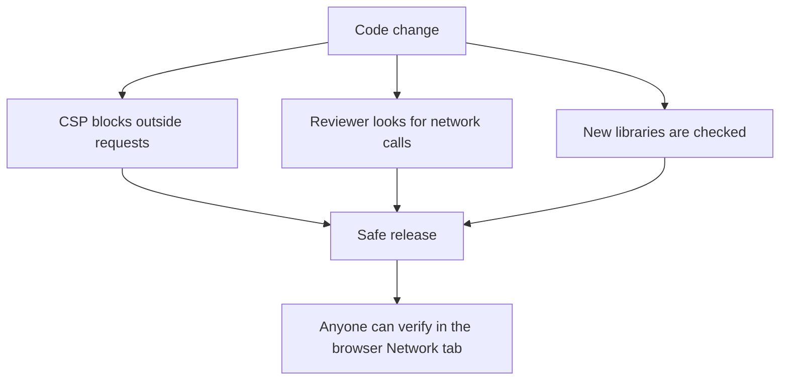

# Privacy rules

The privacy promise is the heart of this project. Everything else can change, but this stays. A PR that breaks it cannot be merged. We will always explain why and help you find another way.

## The rules

- No network request automatically sends user files, or anything taken from user files, to any server or backend. The only outbound network action involving document content is an explicitly user-initiated **Search the web** option in the PDF viewer's text-selection menu, which opens `https://www.google.com/search?q=...` in the user's browser with up to 200 characters of selected text.
- No analytics, telemetry, tracking or ads. No third-party scripts that do any of these.
- No accounts or sign-in.
- No remote fonts, CDNs or scripts at runtime. Bundle everything inside the app.
- Do not keep user files after the session, unless the user saves them on purpose. Prefer working in memory.

## How we keep the promise

Rules written in a document are good, but we also use simple technical checks.



1. **A strict Content-Security-Policy** served via Cloudflare Pages HTTP headers in `public/_headers`:
   ```http
   Content-Security-Policy: default-src 'self'; script-src 'self' 'wasm-unsafe-eval'; style-src 'self' 'unsafe-inline'; img-src 'self' data: blob:; font-src 'self' data:; connect-src 'self' blob:; worker-src 'self' blob:; object-src 'none'; frame-ancestors 'none'; form-action 'self'; base-uri 'self';
   Permissions-Policy: camera=(), microphone=(), geolocation=()
   ```
   - Same-origin network connections and `blob:` URLs (`connect-src 'self' blob:`) are permitted; external origins remain blocked.
   - `'wasm-unsafe-eval'` is restricted strictly for PDF.js WebAssembly fast paths.
   - `'unsafe-inline'` for styles is used for dynamic canvas rendering and layout styles.
   - Camera, microphone, and geolocation are disabled on the web via `Permissions-Policy: camera=(), microphone=(), geolocation=()`.
   - Local production-header testing can be run via `scripts/test-csp-runtime.mjs`.
2. **Reviewer check.** Reviewers search the PR for `fetch(`, `XMLHttpRequest`, `WebSocket`, `sendBeacon` and new `<script>` tags.
3. **Library check.** New packages are checked for tracking or network code, not only for the licence.
4. **Anyone can verify.** Open the browser Network tab, process a file, and see that no request is made.
5. **Desktop shell check.** The Electron app loads only its own files and blocks navigation and network subrequests to external sites. External browser opening via `openExternalUrl` is strictly restricted to HTTPS URLs for the canonical GitHub repository and user-initiated Google Search (`https://www.google.com/search`). The main process reads a PDF only to give it to the window and never sends, logs, or saves the file elsewhere. Electron's crash reporter and auto-updater stay off.
6. **Android shell check.** The Android app loads only its own bundled assets, and `android/app/src/main/AndroidManifest.xml` does not request the `INTERNET` permission. Android hands opened PDFs only to the in-app screen, and no native code or Capacitor plugin transmits user files or telemetry to a server.

## What is allowed and what is not

| Allowed | Not allowed |
|---|---|
| Loading the app files from the same site | Automatically uploading a file, its name, or its text to any server |
| User-initiated web search on selected text in the viewer (`Search the web`) | Background network requests triggered without explicit user action |
| Fonts and images bundled in the app | Google Fonts or any CDN link |
| Saving the user's theme choice in `localStorage` | Saving file contents or file names in storage |
| Error messages shown on screen | Sending error reports to a server |
| Showing a PDF in the viewer, in memory only | A "recent files" list that remembers file names or contents |

If you are not sure about something, just ask in an issue before writing the code. We are happy to help.

## Reporting a privacy problem

For a general question or concern, open an issue with the `privacy` label.

If the problem could expose user data, please do not post it publicly, because this repo is public. Report it privately instead. See [SECURITY.md](../SECURITY.md) for how.
