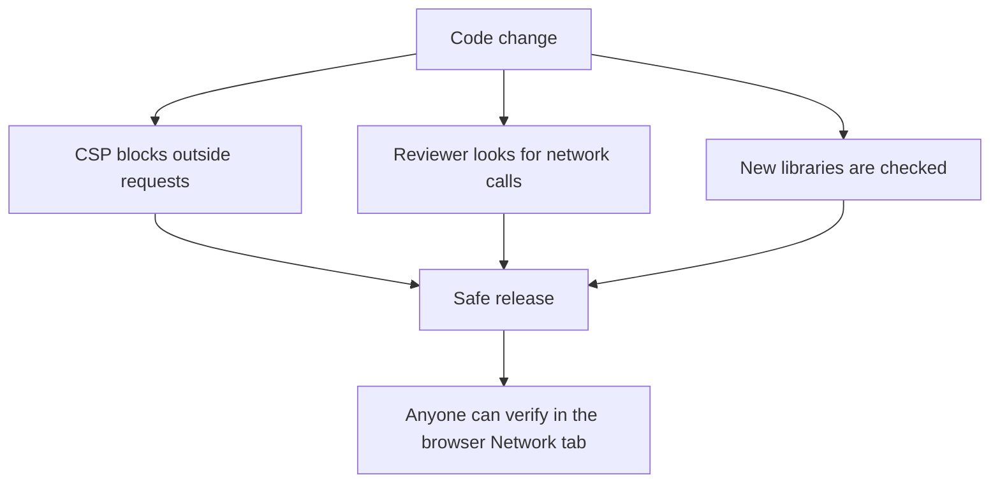

# Privacy rules

The privacy promise is the heart of this project. Everything else can change, but this stays. A PR that breaks it cannot be merged. We will always explain why and help you find another way.

## The rules

- No network request may send user files, or anything taken from user files.
- No analytics, telemetry, tracking or ads. No third-party scripts that do any of these.
- No accounts or sign-in.
- No remote fonts, CDNs or scripts at runtime. Bundle everything inside the app.
- Do not keep user files after the session, unless the user saves them on purpose. Prefer working in memory.

## How we keep the promise

Rules written in a document are good, but we also use simple technical checks.



1. **A strict Content-Security-Policy** served via Cloudflare Pages HTTP headers in `public/_headers`:
   ```http
   Content-Security-Policy: default-src 'self' blob:; script-src 'self' 'wasm-unsafe-eval'; style-src 'self' 'unsafe-inline'; img-src 'self' data: blob:; font-src 'self'; connect-src 'self'; worker-src 'self' blob:; object-src 'none'; frame-ancestors 'none'; base-uri 'self'; form-action 'self';
   Permissions-Policy: camera=(), microphone=(), geolocation=(), payment=()
   ```
   - All network connections outside the local origin are blocked.
   - `'wasm-unsafe-eval'` is restricted strictly for PDF.js WebAssembly fast paths.
   - `'unsafe-inline'` for styles is used for dynamic canvas rendering and layout styles.
   - Camera and sensors are disabled on the web via `Permissions-Policy`. (When the planned Android document scanner is introduced, mobile-specific permissions will be used natively without weakening web isolation).
   - Local production-header emulation verified 0 CSP violations; live Cloudflare edge verification will be completed on production deployment.
2. **Reviewer check.** Reviewers search the PR for `fetch(`, `XMLHttpRequest`, `WebSocket`, `sendBeacon` and new `<script>` tags.
3. **Library check.** New packages are checked for tracking or network code, not only for the licence.
4. **Anyone can verify.** Open the browser Network tab, process a file, and see that no request is made.
5. **Desktop shell check.** The Electron app loads only its own files and blocks navigation to other sites. The main process reads a PDF only to give it to the window. It must never send, log or save the file or its name anywhere else. Electron's crash reporter and auto-updater stay off.
6. **Android shell check.** The Android app loads only its own files. Android gives us a PDF only so the screen can show it. The native side must never send, log or save the file or its name. No plugin that talks to a server. We will also check whether the `INTERNET` permission can be removed.

## What is allowed and what is not

| Allowed | Not allowed |
|---|---|
| Loading the app files from the same site | Sending a file, its name or its text to any server |
| Fonts and images bundled in the app | Google Fonts or any CDN link |
| Saving the user's theme choice in `localStorage` | Saving file contents or file names in storage |
| Error messages shown on screen | Sending error reports to a server |
| Showing a PDF in the viewer, in memory only | A "recent files" list that remembers file names or contents |

If you are not sure about something, just ask in an issue before writing the code. We are happy to help.

## Reporting a privacy problem

For a general question or concern, open an issue with the `privacy` label.

If the problem could expose user data, please do not post it publicly, because this repo is public. Report it privately instead. See [SECURITY.md](../SECURITY.md) for how.
